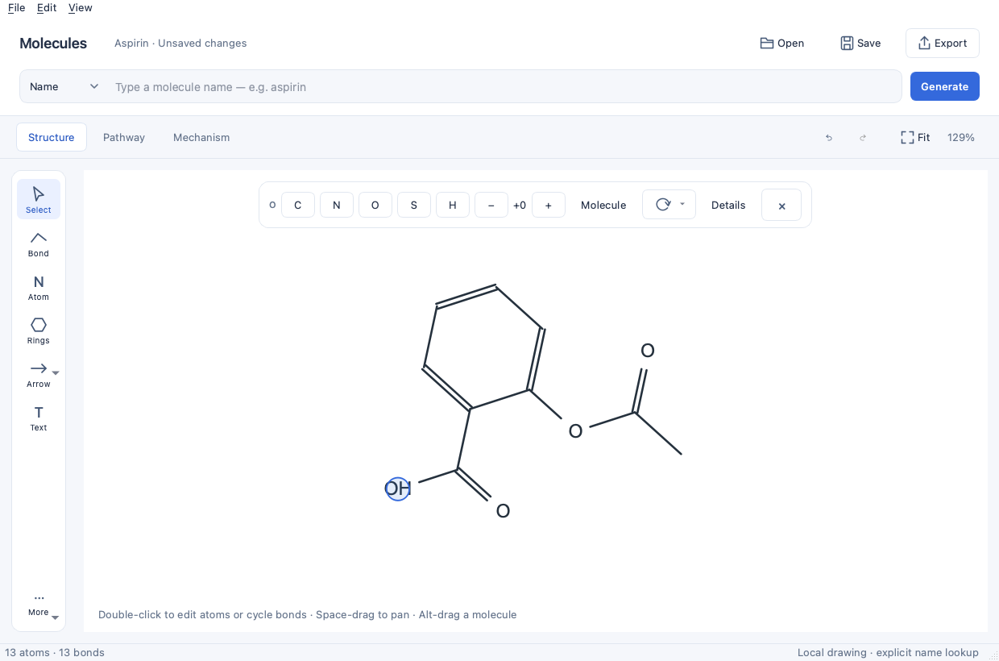
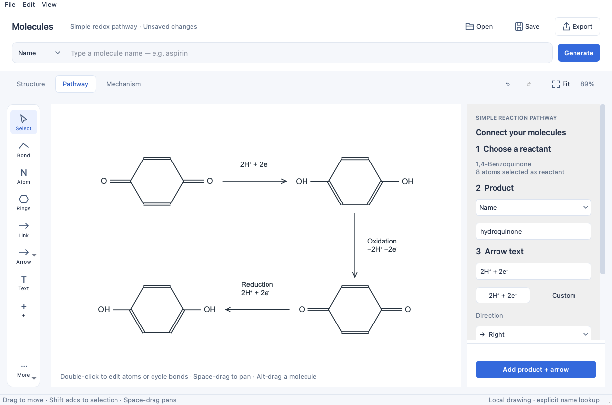

# Molecules

A focused desktop workspace for drawing molecules, reaction pathways, and
mechanisms. Built with Python, PySide6, and RDKit.

Type a molecule name or SMILES, review the structure, edit it on the canvas,
and export a clear figure. **Structure**, **Pathway**, and **Mechanism** modes
keep the tools relevant to the task.

## Screenshots

**Structure editing** — a canvas-first workspace with atom and bond controls
near your selection.



**Simple reaction pathways** — connect molecules with labeled arrows and build
chains that turn right, down, left, or up.



Screenshots show the actual app with example drawings; they are not mockups.

## Features

- **Name → structure:** preview molecules before insertion. Fifteen common names
  work offline; other names use OPSIN on explicit submission. SMILES input works
  offline. Lookup is cancellable and discloses its provider.
- **Direct editing:** atoms, bonds, charges, isotopes, explicit hydrogens, display
  labels, ring templates, wedge/hash/wavy bonds, lone pairs, and radicals. Inline
  labels, contextual controls, copy/paste, layout cleanup, and undo/redo.
- **Movement and rotation:** move whole molecules, drag a rotation handle with
  15° snapping (Alt for a free angle), or enter an exact angle.
- **Simple pathways:** add named/SMILES products in four directions or link
  existing molecules. Captions accept conditions such as `2H⁺ + 2e⁻`, potentials,
  or catalysts. Arrows follow their molecules; captions stay upright.
- **Guided mechanisms:** source/target electron-flow arrows and reviewable
  next-step proposals for supported pair-electron operations.
- **Save and export:** reopen editable `.molecules.json` documents. Export PNG,
  SVG, or PDF with a preview, selection/document content, padding, and transparent,
  white, or custom backgrounds. Editor decorations stay out of exports.

## Run locally

Requires **Python 3.11+**. Clone the repository and enter its root folder:

```sh
git clone https://github.com/aalto-ema/molecules.git
cd molecules
```

You can also download and extract the repository ZIP from GitHub.

### macOS / Linux

```sh
python3 -m venv .venv
source .venv/bin/activate
python -m pip install -e .
python run_app.py
```

### Windows (PowerShell)

```powershell
py -3 -m venv .venv
.\.venv\Scripts\python.exe -m pip install -e .
.\.venv\Scripts\python.exe run_app.py
```

After setup, the root launcher automatically uses `.venv`. The installed
`molecules` command and `python -m molecules` also work inside that environment.
PySide6 and RDKit are installed by pip; there is no separate Qt installation.
Linux needs a graphical desktop and the system libraries required by Qt. On
Ubuntu, install the EGL/OpenGL runtime libraries with
`sudo apt-get install libegl1 libopengl0`; these are needed for headless tests too.

The app has been visually checked on macOS. CI is configured for Linux, macOS,
and Windows; live cross-platform usability testing remains ongoing.

## Try the workflows

**Draw a molecule.** Choose Name or SMILES, press Generate, review the preview,
and add it. Double-click an atom to edit its element/display label, or a bond to
cycle its order. Click an atom for charge controls; use Details for other fields.

**Build a pathway.** Switch to Pathway, click a reactant, enter a product and arrow
text, choose a direction, and press Add product + arrow. The product becomes the
next reactant. Link connects existing molecules in source/target order.
Double-click an arrow to edit its caption, or select it to reverse its direction.
Try **Try a redox pathway** in the guide.

**Draw a mechanism.** Switch to Mechanism, choose the electron count, click a
source atom/bond, then a target. Hover previews the curve; Escape cancels it.
Review next step shows proposed bond/charge changes before adding a new step.
Initial assistance covers pair-electron bond formation/cleavage and proton
transfer with an explicit hydrogen and both transfer arrows. Unsupported flows
remain editable manual drawings.

Editable examples:

- [Ethanol](examples/ethanol.molecules.json)
- [Electrochemical pathway](examples/electrochemical-pathway.molecules.json)
- [Carbonyl addition](examples/carbonyl-addition.molecules.json)

### Useful gestures

| Action | Gesture |
| --- | --- |
| Select / add to selection | Click / Shift-click |
| Move a whole molecule | Alt-drag an atom |
| Rotate a whole molecule | Select it, then use Rotate or its circular handle |
| Edit an atom label / cycle a bond order | Double-click |
| Pan / zoom / show the full drawing | Space-drag / mouse wheel / Fit |
| Cancel a gesture | Escape |
| Select / Atom / Bond / Flow / Text / Link tools | V / A / B / E / T / L with canvas focus |
| Change element / bond order / charge | C, N, O, S, P, F, H / 1, 2, 3 / +, − |

File, clipboard, and undo/redo commands use platform shortcuts shown in the menus.
Text inputs retain normal typing behavior.

## Scope

Molecules is an early desktop editor. It does not predict reaction products,
guarantee mechanism correctness, or read ChemDraw proprietary files. The offline
name library is small, and OPSIN cannot resolve every common name. Unknown-name
lookup sends the submitted query to OPSIN; local editing, SMILES, saving, and
export work offline.

Chemical validation is advisory so unusual-valence intermediates remain editable.
Display abbreviations do not expand into fragments. Advanced stereochemical
editing, fused-ring gestures, chemical interchange, autosave/recovery, and
installers are future work. See the [roadmap](docs/ROADMAP.md).

Native format v4 retains layout, annotations, provenance, and step identity;
versions 1–3 remain readable. SVG and PDF preserve vector geometry. Transparent
PDF means an unpainted page, which most viewers display as white.

## Development

```sh
python -m pip install -e '.[dev]'
python -m unittest discover -s tests
python -m pytest -q
python -m ruff check .
python -m build
```

For headless Qt tests, set `QT_QPA_PLATFORM=offscreen`. See
[CONTRIBUTING.md](CONTRIBUTING.md) for setup, verification, and contribution guidance.
`requirements-tested.txt` records a tested macOS environment; it is not a portable
lockfile or the recommended installation command.

## Documentation

- [Product intent](docs/PRODUCT.md) and [UX specification](docs/UX.md)
- [Architecture](docs/ARCHITECTURE.md) and [native file format](docs/FILE_FORMAT.md)
- [Roadmap](docs/ROADMAP.md) and [changelog](CHANGELOG.md)
- [Publishing this repository](docs/PUBLISHING.md)
- [Instructions for coding agents](AGENTS.md)

## License and acknowledgments

Molecules is licensed under the [MIT License](LICENSE). Dependencies retain their
own licenses.

Built with [Qt for Python](https://doc.qt.io/qtforpython-6/),
[RDKit](https://www.rdkit.org/), and [OPSIN](https://www.ebi.ac.uk/opsin/).
